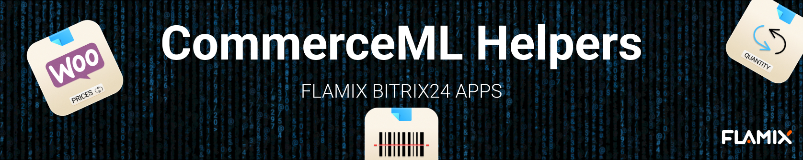
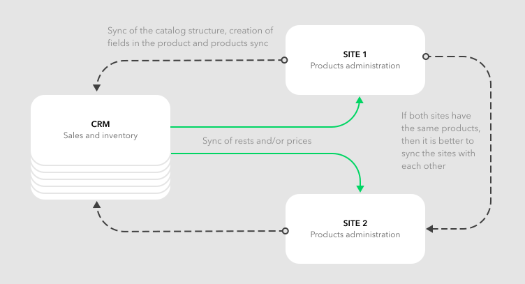
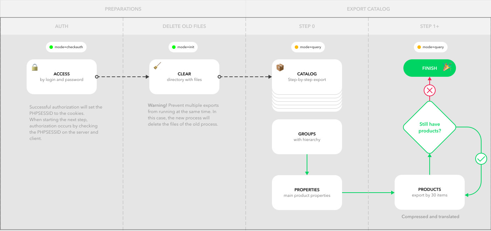

# CommerceML

Product sync between a CMS site and Bitrix24 (FLAMIX apps) over a simplified CommerceML exchange.

- Products, categories and fields are created and edited only on the site; Bitrix24 pulls their structure.
- Bitrix24 pushes stock and prices back to the site. It never uploads the catalog to the site.



Inventory API and sync actions: https://inventory.app.flamix.solutions/docs (Postman collection or OpenAPI spec).

## Install

```bash
composer require flamix/commerceml
```

## Documentation

See [docs/](docs/) for full documentation.

AI: Laravel Boost guideline and skills in resources/boost/.

- [Setup](docs/setup.md) — boot order, the exchange class, `config.php`, the protocol
- [Export](docs/export.md) — product, category and attribute callbacks, export steps
- [Import](docs/import.md) — upload, zip, the rests/prices/products handlers
- [XML and helpers](docs/xml.md) — `OneC\CommerceML` build/translate/parse, `commerceml_*()` helpers


